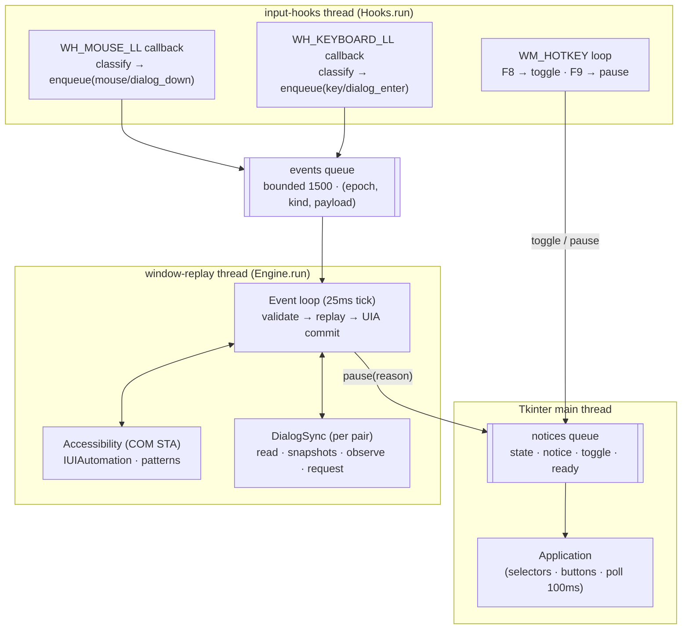
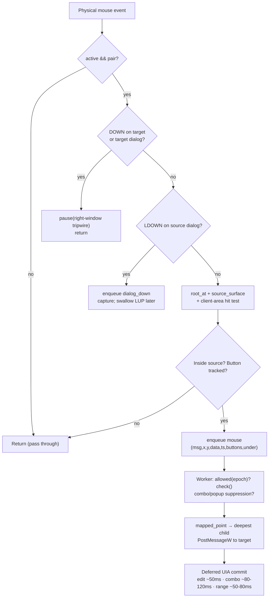
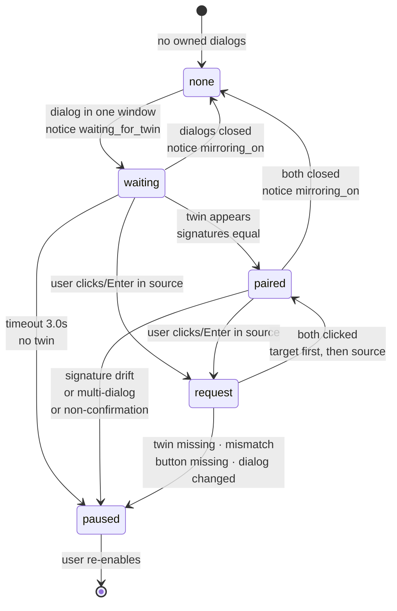
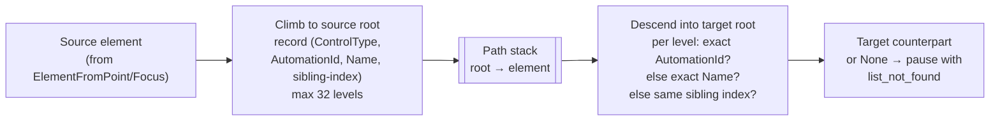

# Tap Duplicator

> A local, one-way, window-bound input-replication helper that mirrors your taps, text, and decisions from one Windows application instance to a second, pixel-aligned instance — safely.

[](LICENSE)
[](https://www.python.org/)
[](https://www.microsoft.com/windows)
[](https://docs.python.org/3/library/tkinter.html)
[](https://learn.microsoft.com/en-us/windows/win32/winauto/entry-uiauto-win32)
[](build.ps1)
[](test_duplicate.py)

> [!NOTE]
> **Tap Duplicator is not a logging library, remote-control tool, or macro recorder.** It is a safety-focused desktop assistant that replicates input strictly from a selected **source (left)** window to a selected **target (right)** window on the same machine. There is no network I/O, no scripting engine, and no autonomous clicking — every mirrored action originates from an explicit physical user gesture.

> [!IMPORTANT]
> **Windows-only.** This project binds directly to the Win32 API (`user32.dll`, `kernel32.dll`) and Microsoft UI Automation (`UIAutomationCore.dll`) via `ctypes`/`comtypes`. It does not run on macOS or Linux.

---

## Table of Contents

- [Tap Duplicator](#tap-duplicator)
- [Table of Contents](#table-of-contents)
- [Features](#features)
- [Tech Stack \& Architecture](#tech-stack--architecture)
  - [Core Stack](#core-stack)
  - [Project Structure](#project-structure)
  - [Key Design Decisions](#key-design-decisions)
- [Getting Started](#getting-started)
  - [Prerequisites](#prerequisites)
  - [Installation](#installation)
- [Testing](#testing)
- [Deployment](#deployment)
- [Usage](#usage)
  - [Basic Usage](#basic-usage)
  - [Advanced Usage](#advanced-usage)
- [Configuration](#configuration)
- [License](#license)
- [Support the Project](#support-the-project)

---

## Features

An exhaustive list of what Tap Duplicator does — and the guardrails that make it safe to use on real work:

**Core replication**

- 🖱️ **One-way mouse mirroring (left → right)** — left/right/middle button down/up, drags, moves-during-drag, vertical and horizontal wheel — translated from the source client area to the identical client-area point in the target.
- ⌨️ **Window-bound keyboard mirroring** — navigation and commit keys (`Backspace`, `Tab`, `Enter`, `Esc`, `Space`, `PgUp/PgDn`, `Home/End`, arrows, `Delete`) are posted to the target only while the source surface owns the foreground.
- 🔤 **Value-level text synchronization** — edit controls are synced through UI Automation `ValuePattern`/`LegacyIAccessiblePattern` as their *resulting value*, so `Ctrl+A`, paste, IME/layout switches, and dead keys replicate correctly instead of replaying raw keystrokes.
- 📋 **Qt-aware combo-box synchronization** — `QComboBox` selections are resolved by value (exact name match), then committed through the target's own popup when Qt 5's `SelectionItem.Select` only selects the hidden view row.
- 🎚️ **Range-control synchronization** — sliders, spinners, and scroll bars (`RangeValuePattern`) are synced by numeric value with read-only and range-mismatch protection.
- 🖱️ **Popup-aware click suppression** — while a source combo popup is open, raw mouse traffic is suppressed and replaced by a deferred, verified value commit, so the two popup mouse grabs never compete.

**Safety & correctness guardrails**

- 🛡️ **Pixel-exact geometry gate** — mirroring refuses to start (and auto-pauses) unless both client areas are identically sized. Layouts are translated, never scaled.
- 🛡️ **Client-area hit testing** — title-bar, border, and non-client clicks are never duplicated. Only in-client source gestures are queued.
- 🛡️ **Process-pair validation** — source and target must be two distinct `HWND`s in two distinct PIDs. Self-targeting (`Tap Duplicator`'s own window) is excluded from discovery.
- 🛡️ **Right-window tripwire** — clicking the target (or its owned dialog) instantly pauses mirroring to prevent divergence.
- 🛡️ **Epoch invalidation** — every `pause()` bumps a monotonic epoch; any queued event from a stale epoch is discarded by the worker. `Stop` can never leak a partial drag into a phantom click.
- 🛡️ **Graceful drag cancellation** — on emergency stop with buttons held, the engine posts `WM_CANCELMODE` (`0x1F`) plus button-up messages at `(-1000, -1000)` so a partial drag cannot activate a target button.
- 🛡️ **Access-level diagnostics** — `PostMessageW` returning Win32 error `5` (UAC integrity-level mismatch) surfaces a human-readable remediation instead of a silent failure.
- 🛡️ **Overflow protection** — the event queue is bounded (`maxsize=1500`); on saturation the engine pauses with an explicit notice rather than replaying a lossy, desynchronized stream.
- 🛡️ **Double-click synthesis** — consecutive same-button presses are upgraded to `WM_*DBLCLK` using the system's real `GetDoubleClickTime` and `GetSystemMetrics(SM_CX/YDOUBLECLK)` thresholds.
- 🛡️ **Modifier fidelity** — live `Shift`/`Ctrl` state from `GetAsyncKeyState` is OR-ed into mirrored mouse `wParam`, so `Ctrl+Click` / `Shift+Click` multi-select works in the target.

**Confirmation-dialog safety**

- 💬 **Strict confirmation matcher** — only dialogs with a non-empty static message, 1–3 uniquely-keyed buttons from a closed allowlist (`yes/no/ok/cancel/abort/retry/ignore` + `uk/ru/zh` aliases), and *no* edit/combo/spinner controls are eligible.
- 💬 **Signature equality gate** — heading + message + sorted button keys must match byte-for-byte (after `&`-stripping, whitespace-collapsing, casefolding) before anything is mirrored. Mismatch ⇒ zero clicks, mirroring off.
- 💬 **Explicit-decision-only replay** — the mirrored key always comes from the user's *actually clicked* source button or the *focused/default* `Enter` target. The engine never infers or defaults to `Yes`.
- 💬 **Drag-off cancels** — pressing a button and releasing off-button (or on a different button) cancels both clicks, matching native button semantics.
- 💬 **Enter interception** — a single physical `Enter` in a source dialog is captured (auto-repeat swallowed) and re-emitted as explicit clicks in both dialogs — target first, then source — without waiting on unrelated long operations.
- 💬 **Multi-dialog refusal** — more than one owned dialog per process, non-confirmation dialogs (forms, file pickers), or dialog-mid-click mutation all pause mirroring loudly instead of guessing.

**Desktop & i18n experience**

- 🪟 **Native Windows UX** — Tkinter/Clam interface, per-monitor-V2 DPI awareness (manifest + `SetProcessDpiAwarenessContext`), single-instance mutex with a localized "already running" message box.
- 🌍 **First-class English + Ukrainian localization** — every user-facing string (including backend errors and dynamic prefixes like `Ошибка мыши: …`) is rendered through `i18n.render()`; first run defaults to English; switching is live and persisted.
- 🧾 **Bounded diagnostics** — `RotatingFileHandler` (`diagnostics.log`, 250 KB × 2 files) at `WARNING` level; replay pauses are logged as `Replay paused: <ExceptionType>` without dumping user content.
- 📐 **One-click tiling** — `Place side by side` snaps both windows to exact left/right halves of the source monitor's work area via `MonitorFromWindow`/`GetMonitorInfoW`/`SetWindowPos`.
- ⌨️ **Global hotkeys with graceful degradation** — `F8` toggle / `F9` stop via `RegisterHotKey` with `MOD_NOREPEAT`; if a key is already taken, a localized notice tells the user to use the on-screen buttons instead of failing.

> [!TIP]
> The fastest path to a stable session: open two instances of the same app → `Refresh windows` → select Left/Right → `Place side by side` → open the **same tab** in both → align scroll positions → `Mirror · F8`.

---

## Tech Stack & Architecture

### Core Stack

| Layer | Technology | Role |
|---|---|---|
| Language | **Python 3.10+** (3.11/3.12 recommended) | All application code; `from __future__ import annotations` throughout |
| GUI | **Tkinter + ttk (Clam theme)** | `tap_duplicate.py` — selectors, toggles, status, localized messaging |
| Win32 interop | **`ctypes` → `user32.dll` / `kernel32.dll`** | `win_api.py` — window enumeration, hooks, `PostMessageW` replay, DPI, mutex |
| Accessibility | **`comtypes` → `UIAutomationCore.dll`** | `automation.py` — `IUIAutomation` element tree, Value/Selection/Range/Legacy patterns |
| Packaging | **PyInstaller 6.x (`--onefile --windowed`)** | `build.ps1` — single-file `Tap Duplicator.exe` with manifest + icon |
| Persistence | **`settings.json`** (UTF-8 JSON) | `keyboard` / `wheel` toggles + `language` code |
| Diagnostics | **stdlib `logging` + `RotatingFileHandler`** | `diagnostics.log` — bounded, warning-level operational log |
| Testing | **stdlib `unittest` + `unittest.mock`** | `test_*.py` — boundary, dialog-decision, i18n, and live-dialog harness tests |

> [!NOTE]
> There is intentionally **no third-party GUI framework, no networking, and no background service**. The entire runtime is two threads plus the Tkinter main loop, and every Windows call goes through the thin, typed `win.api()` helper in `win_api.py`.

### Project Structure

```text
tap_duplicate/
├── tap_duplicate.py      # Tkinter GUI, settings, single-instance mutex, logging setup, main loop
├── automation.py         # Engine: hooks → queue → worker; UIA value/selection/range sync
├── win_api.py            # ctypes Win32 primitives: windows, hooks, PostMessage replay, tiling
├── dialog_sync.py        # Confirmation-dialog matcher + explicit-decision replayer
├── i18n.py               # EN/UK string table, Message dataclass, backend-message renderer
├── test_duplicate.py     # Window discovery + replay-boundary unit tests
├── test_dialog_sync.py   # Dialog-decision + Enter-interception regression tests
├── test_i18n.py          # Translation coverage + live language-switch tests
├── test_live_dialogs.py  # Explicit two-fixture desktop harness (--controller / --role A|B)
├── requirements.txt      # Pinned runtime + build deps (comtypes, pyinstaller)
├── settings.json         # Persisted user prefs (keyboard, wheel, language)
├── app.manifest          # Win32 manifest: asInvoker, PerMonitorV2 DPI awareness
├── build.ps1             # Venv + UIA wrapper warmup + PyInstaller one-file build
├── tap_duplicate.ico     # Application icon (taskbar / EXE)
├── diagnostics.log       # Rotating operational log (gitignored in real use)
├── LICENSE               # Apache License 2.0
└── Tap Duplicator.exe    # Built artifact (PyInstaller one-file, Windows)
```

<details>
<summary><strong>📂 Deep dive: module responsibilities and call graph</strong></summary>

```text
tap_duplicate.py (Tkinter main thread)
│  owns: Application(root), notices queue, poll() pump (100 ms)
│  calls: win.windows(), win.arrange(), Engine.start/pause/stop()
│
├── win_api.py (no side effects on import; no input sent on import)
│   ├── Window / windows() / dialogs() / is_dialog_for()
│   ├── client_box() / mapped_point() / packed_point() / mouse_message() / post()
│   ├── same_size() / arrange() / dpi_awareness()
│   └── Hooks(threading.Thread): WH_MOUSE_LL(14) + WH_KEYBOARD_LL(13) + F8/F9 hotkeys
│       └── callbacks only enqueue; all COM/UIA work happens elsewhere
│
├── automation.py (worker thread "window-replay" + hooks thread "input-hooks")
│   ├── Accessibility: COM STA wrapper (CoInitializeEx / CoUninitialize)
│   │   ├── root()/at()/of_type()/parent()/control()/counterpart()
│   │   ├── text_value()/set_text() · selection()/set_selection() · sync_range()
│   └── Engine: active/closed/ready Events, epoch counter, bounded queue (1500)
│       ├── on_mouse()/on_key()/hotkey()  → enqueue("mouse"|"key"|"dialog_*")
│       ├── run(): validate → replay → observe dialogs → deferred UIA commits
│       └── check(): closed/minimized/resized detection (every 150 ms)
│
├── dialog_sync.py (owned by worker thread; constructed per pair)
│   ├── Button / Confirmation(signature, button(), at(), enter_button())
│   └── DialogSync: read() → snapshots() → observe() → request(dialog_down/up/enter)
│
└── i18n.py (pure; safe to import anywhere)
    ├── STRINGS[key][en|uk], BACKEND[legacy_ru] → key, Message(key, values)
    └── language_code() / text() / render() (prefix + hotkey regex handling)
```

**Import direction is strictly acyclic:** `tap_duplicate → {automation, win_api, i18n}`, `automation → {win_api, dialog_sync}`, `dialog_sync → {win_api}`, `i18n → {}`. Tests import modules and mock at the `win.*` seam.

</details>

### Key Design Decisions

**1. Post messages, don't synthesize input.**
The engine replays via `PostMessageW` to the target window (descending to the deepest `ChildWindowFromPointEx` child for mouse messages) instead of `SendInput`. This keeps the user's physical cursor and focus untouched, avoids stealing foreground, and confines every effect to the selected target. The trade-off — applications that read raw global input state may ignore posted messages — is accepted deliberately: confinement beats universality.

**2. Hooks enqueue; the worker decides.**
Low-level hook callbacks (`WH_MOUSE_LL`, `WH_KEYBOARD_LL`) run on a dedicated thread with its own message loop and do nothing but classify and `put_nowait` bounded events. All COM/UIA calls, geometry checks, dialog matching, and `PostMessage` replay run on the worker thread. This keeps hook latency minimal (no dropped system input) and keeps COM apartment discipline clean (STA `CoInitializeEx` on exactly one thread).

**3. Epochs make Stop total.**
`pause()` clears `active`, increments `epoch`, and resets button state. The worker checks `allowed(epoch)` — active + epoch match + both windows valid — before *every* replay and *every* deferred UIA commit. A stop issued mid-drag, mid-popup, or mid-dialog-wait cannot leak a stale click.

**4. Values over keystrokes for text.**
Keyboards lie: layouts, IME, `Ctrl+V`, auto-correct. So text fields are synced by reading the source `ValuePattern` after the dust settles (debounced ~40–50 ms) and calling `SetValue` on the counterpart. Password fields are never copied; read-only fields are never written (protecting per-instance output paths).

**5. Never infer a destructive decision.**
Dialog mirroring is a separate, stricter pipeline with its own allowlist, signature gate, and "no match ⇒ no click" invariant. `Enter` resolves to the focused button, else the unique default — and raises "could not be identified" rather than guessing `Yes`. Every decision test in `test_dialog_sync.py` asserts the negative: mismatched message, missing counterpart, drag-off, and stopped-engine cases must produce **zero** `mouse_message` calls.

**6. Translate, never scale.**
`mapped_point()` raises `ValueError` unless both client areas are exactly equal. Combined with the `Place side by side` tiler and the 150 ms `same_size` watchdog, this guarantees the Nth pixel in the source maps to the Nth pixel in the target — the only mapping that keeps Qt item views, canvases, and custom controls aligned.

<details>
<summary><strong>🧭 Architecture diagrams (Mermaid): threading, pipeline, and dialog state machine</strong></summary>

**Threading model — who runs where:**



**Mouse-event pipeline — from physical click to mirrored click:**



**Dialog-sync state machine (`DialogSync.observe` + `request`):**



**UIA counterpart resolution (`Accessibility.counterpart`):**



</details>

> [!WARNING]
> **Integrity levels matter.** If the helper runs unelevated but a target app runs elevated (or vice versa), Windows blocks `PostMessageW` with access-denied. Run the helper and **both** application instances at the same privilege level (all normal, or all elevated).

> [!CAUTION]
> Mirroring replays real input into a real application. Always verify the first few mirrored actions land where you expect — especially in combo boxes and confirmation dialogs — before operating at speed.

---

## Getting Started

### Prerequisites

| Requirement | Minimum | Notes |
|---|---|---|
| OS | **Windows 10 1809+ / Windows 11 (x64)** | Win32 hooks + UIA require a real Windows desktop session (no headless/RDP-console caveats beyond normal hooks) |
| Python | **3.10+** (3.11/3.12 recommended) | Only needed for source runs and tests; end users can use the prebuilt `Tap Duplicator.exe` |
| pip | Any recent | Used to install the two pinned deps |
| PowerShell | 5.1+ | Only needed to run `build.ps1` |
| Two app instances | Same app, two windows | Same version, same layout; both restorable (not minimized), same privilege level |

> [!NOTE]
> No compiler, no Docker, no Node.js. The dependency surface is exactly two pinned packages: `comtypes` (UIA bindings) and `pyinstaller` (build-time only).

### Installation

**Option A — run the prebuilt app (end users):**

```powershell
# 1. Get the repository (or just the EXE from your release channel)
git clone https://github.com/assembly-automation-hub/tap_duplicate.git
cd tap_duplicate

# 2. Launch — no install, no admin, no Python required
.\Tap` Duplicator.exe
```

**Option B — run from source (developers):**

```powershell
# 1. Clone
git clone https://github.com/assembly-automation-hub/tap_duplicate.git
cd tap_duplicate

# 2. Create and activate a virtual environment
python -m venv .venv
.\.venv\Scripts\Activate.ps1

# 3. Install pinned dependencies
python -m pip install --disable-pip-version-check -r requirements.txt

# 4. Warm up the UIA COM wrappers (first run generates comtypes.gen.*)
python -B -c "from comtypes.client import GetModule; GetModule('UIAutomationCore.dll')"

# 5. Launch
python tap_duplicate.py
```

> [!TIP]
> Prefer one command? `.\build.ps1` performs steps 2–4 plus the PyInstaller build automatically — and leaves you a runnable `.venv` for source runs too.

<details>
<summary><strong>🔧 Troubleshooting & alternative installs</strong></summary>

**`Python was not found` in PowerShell:**
- Install from [python.org](https://www.python.org/downloads/) and tick **"Add python.exe to PATH"**, or use `py -3.12 -m venv .venv`.
- Verify: `python --version` should print `3.10.x` or newer.

**`pip install` fails on `comtypes`:**
- Upgrade pip first: `python -m pip install -U pip`, then retry with `--disable-pip-version-check -r requirements.txt`.
- `comtypes==1.4.17` is a pure-Python wheel — no C++ build tools needed. If your mirror blocks it, `pip install comtypes` (unpinned) also works for local runs.

**`GetModule('UIAutomationCore.dll')` fails:**
- You must run this on Windows with UI Automation present (all supported Windows 10/11 SKUs ship it). It generates `comtypes/gen/*UIAutomationClient*` so PyInstaller can freeze them.
- If generation succeeds but the EXE complains at runtime, ensure `build.ps1`'s `--hidden-import comtypes.gen.UIAutomationClient --collect-submodules comtypes.gen` flags were used.

**Execution policy blocks `build.ps1` / `Activate.ps1`:**
```powershell
Set-ExecutionPolicy -Scope CurrentUser RemoteSigned
```
Then re-run. Alternatively, build step-by-step with `cmd.exe` instead of PowerShell.

**Alternative: build from source without the script (explicit PyInstaller invocation):**
```powershell
.\.venv\Scripts\python.exe -m PyInstaller --noconfirm --clean --onefile --windowed `
  --name 'Tap Duplicator' --distpath . --workpath .build --specpath .build `
  --manifest .\app.manifest --icon .\tap_duplicate.ico `
  --hidden-import comtypes.gen.UIAutomationClient --collect-submodules comtypes.gen `
  tap_duplicate.py
```

**Alternative: portable dev run without a venv (not recommended):**
```powershell
python -m pip install --user -r requirements.txt
python -B tap_duplicate.py
```

**Antivirus flags the fresh EXE:**
- Unsigned PyInstaller one-file binaries are occasionally heuristic-flagged. Either run from source, or sign the EXE with your organization's code-signing certificate before distributing (see [Deployment](#deployment)).

</details>

---

## Testing

> [!NOTE]
> The fast suites (`test_duplicate`, `test_dialog_sync`, `test_i18n`) run anywhere Python + Tkinter are available — Win32 calls are fully mocked. The live harness (`test_live_dialogs.py --controller`) requires a real Windows desktop.

**Run everything (fast suites):**

```powershell
# From the repo root, with .venv activated:
python -m unittest test_duplicate test_dialog_sync test_i18n -v
```

**Run suites individually:**

```powershell
python -m unittest test_duplicate -v      # window discovery + replay boundaries
python -m unittest test_dialog_sync -v    # dialog decisions + Enter interception
python -m unittest test_i18n -v           # translation coverage + language prefs
```

**What each suite proves:**

| Suite | Key assertions |
|---|---|
| `test_duplicate.py` | Unsuitable windows excluded (hidden, uncaptioned, owned, self-PID); title-bar clicks never queued; foreign-app clicks never queued; source client clicks queued exactly once; keyboard outside source ignored; `pause()` invalidates stale epochs; unequal layouts raise; `packed_point` handles negative drag coords |
| `test_dialog_sync.py` | Focus-`No` preserved on `Enter` (both dialogs get `(50,20)`); focus overrides default; unknown focus+default ⇒ no guess; mismatched message ⇒ **zero** clicks; missing counterpart ⇒ **zero** clicks; stopped engine ⇒ **zero** clicks; clicked-Yes replays target-first `(401,…)` then source `(301,…)`; drag-off cancels both; one physical `Enter` (with auto-repeat) queues exactly one decision |
| `test_i18n.py` | Invalid prefs fall back to `en`; every key has identical `{format}` fields in `en`/`uk`; **every** Cyrillic backend literal in shipped code renders to a translation (AST-scanned); dynamic prefixes (`Ошибка мыши: …`) and hotkey-busy messages render per-language; live switch re-translates title/heading/status/counter and persists `language` to `settings.json`; corrupt settings degrade to `{}` |
| `test_live_dialogs.py` | Explicit two-fixture desktop harness — spins `A` + `B` Tk fixture windows, drives the real `Engine`, asserts mirrored Yes/No answers. See below. |

**Live desktop harness (explicit, opt-in, camera-free):**

```powershell
# Terminal 1 — start the controller (spawns fixtures A and B, starts the real Engine):
python test_live_dialogs.py --controller

# The controller writes JSON status to .dialog_test\controller.json and listens for:
#   .dialog_test\A_command.json / B_command.json  ({"sequence": N, "action": "show"|"quit"})
#   .dialog_test\driver.json                      ({"sequence": N, "kind": "click"|"enter", "point": [x, y]})
# Stop by creating the file .dialog_test\stop
```

> [!IMPORTANT]
> `test_live_dialogs.py` **never connects to external applications or cameras** — the `BODY` text and window captions literally state `TEST ONLY / NO CAMERAS`. It only drives its own Tk fixtures. Status/command files live in the gitignored scratch dir `.dialog_test/`.

<details>
<summary><strong>🧪 Deep dive: testing philosophy, mocking seams, and linter guidance</strong></summary>

- **Seam-first mocking.** All Win32 surface area funnels through `win_api.py` module-level functions (`enum_windows`, `title`, `pid_of`, `client_box`, `mouse_message`, …), so tests `patch.multiple(win, …)` or `patch.object(win, …)` without touching `ctypes`. `Engine.__new__(Engine)` + hand-built fields lets boundary tests exercise `on_mouse`/`on_key`/`enqueue`/`pause` with zero threads and zero COM.
- **Negative assertions are the point.** The most valuable tests assert what *must not happen*: no queue growth for foreign clicks, no `mouse_message` for mismatched dialogs, no guessed `Yes`. If you extend replay or dialog logic, add the negative test first.
- **i18n AST sweep.** `test_i18n.py::test_every_backend_message_is_translated` parses all four shipped modules and requires every long Cyrillic literal to round-trip through `i18n.render()` in both languages. New backend messages must get an `entry(…)` + `BACKEND` mapping or this test fails loudly.
- **No linter is pinned**, but the codebase follows a consistent style (4-space, ~120-col, `snake_case`, module docstrings). Recommended local checks:
  ```powershell
  python -m py_compile tap_duplicate.py automation.py win_api.py dialog_sync.py i18n.py
  python -m pyflakes . 2>$null    # optional, if installed
  python -m flake8 --max-line-length=120 --extend-ignore=E203,W503 . 2>$null  # optional
  ```

</details>

---

## Deployment

**Standard path — one-file EXE via `build.ps1`:**

```powershell
# Produces .\Tap Duplicator.exe (windowed, manifest + icon embedded)
.\build.ps1
```

What the script does, step by step:

1. Creates `.venv` if missing (`python -m venv .venv`).
2. Installs `requirements.txt` into it.
3. Warms the UIA wrappers (`GetModule('UIAutomationCore.dll')`) so `comtypes.gen.*` exists before freezing.
4. Runs PyInstaller with `--noconfirm --clean --onefile --windowed`, embedding `app.manifest` (DPI `PerMonitorV2`, `asInvoker`) and `tap_duplicate.ico`, with `--hidden-import`/`--collect-submodules comtypes.gen` so the frozen app finds its UIA bindings.

> [!TIP]
> Build outputs: the EXE lands in the repo root (`--distpath .`); intermediates go to `.build/` (safe to delete). `settings.json` and `diagnostics.log` are resolved relative to the EXE at runtime (`APP_DIR`), so the app is XCOPY-portable — ship the single EXE and it creates its sidecars on first run.

**Release checklist:**

- [ ] `python -m unittest test_duplicate test_dialog_sync test_i18n` green on the build machine.
- [ ] `.\build.ps1` succeeds; smoke-test the EXE: refresh → tile → mirror a click → `F9` stops.
- [ ] Verify both target apps and the helper run at the **same integrity level** (all unelevated is the norm).
- [ ] (Recommended) Code-sign the EXE to avoid SmartScreen/heuristic friction.
- [ ] Ship `LICENSE` alongside, or link it from your release notes (Apache-2.0 §4a).

<details>
<summary><strong>🚀 Deep dive: CI/CD template, signing, and containerization notes</strong></summary>

**GitHub Actions — Windows build + test (drop-in `.github/workflows/build.yml`):**

```yaml
name: build
on:
  push:
    branches: [main]
  pull_request:
jobs:
  windows:
    runs-on: windows-latest
    steps:
      - uses: actions/checkout@v4
      - uses: actions/setup-python@v5
        with:
          python-version: "3.12"
      - name: Install deps
        run: python -m pip install --disable-pip-version-check -r requirements.txt
      - name: Unit tests
        run: python -m unittest test_duplicate test_dialog_sync test_i18n -v
      - name: Warm UIA wrappers
        run: python -B -c "from comtypes.client import GetModule; GetModule('UIAutomationCore.dll')"
      - name: Build EXE
        shell: pwsh
        run: |
          python -m PyInstaller --noconfirm --clean --onefile --windowed `
            --name 'Tap Duplicator' --distpath . --workpath .build --specpath .build `
            --manifest .\app.manifest --icon .\tap_duplicate.ico `
            --hidden-import comtypes.gen.UIAutomationClient --collect-submodules comtypes.gen `
            tap_duplicate.py
      - uses: actions/upload-artifact@v4
        with:
          name: Tap-Duplicator-exe
          path: Tap Duplicator.exe
```

**Code signing (recommended for distribution):**

```powershell
# With an Authenticode cert in the CurrentUser store:
Set-AuthenticodeSignature '.\Tap Duplicator.exe' `
  -Certificate (Get-ChildItem Cert:\CurrentUser\My -CodeSigningCert | Select-Object -First 1) `
  -TimestampServer http://timestamp.digicert.com -HashAlgorithm SHA256
```

**Containerization — not applicable (by design):**
This is a Win32 desktop assistant that installs global low-level hooks and drives HWNDs — it needs an interactive user session with a real window station. It cannot run in Docker/Windows Server Core, Nano Server, or headless CI agents. For automated validation in CI, run the mocked unit suites; reserve the live dialog harness for interactive QA machines.

**Side-by-side / rollback:**
The app is a single file with additive sidecars (`settings.json`, `diagnostics.log`). Rollback = replace the EXE. User preferences survive upgrades untouched.

</details>

> [!WARNING]
> Never run two copies of the helper simultaneously — the `Local\TapDuplicator_4198C5ED` mutex intentionally blocks the second instance to prevent double-hooking and duplicate replay.

---

## Usage

### Basic Usage

**The 60-second happy path (GUI):**

1. Open **two instances** of the same application (e.g. two device-configuration windows).
2. Launch `Tap Duplicator.exe` (or `python tap_duplicate.py`).
3. Click **`Refresh windows`** — both instances appear as `PID … · folder · WxH`.
4. Select the **Left window** (source — where you click) and **Right window** (target — where taps land).
5. Click **`Place side by side`** — both windows snap to exact halves so sizes match.
6. In both windows, open the **same tab/screen** and align scroll positions.
7. Leave ☑ **Text input** and ☑ **Scrolling** on (or uncheck to narrow what mirrors).
8. Click **`Mirror · F8`** (or press `F8`). The status bar turns green: `Mirroring on: left → right`.
9. **Work only in the left window.** Clicks, drags, typing, wheel, combos, sliders, and Yes/No confirmations mirror right.
10. Press **`F9`** (or `Stop · F9`) the moment anything looks off — mirroring pauses instantly and stays off until you re-enable it.

> [!TIP]
> The click counter (`Clicks: N`) increments on every mirrored mouse-up and every mirrored dialog decision — a quick sanity check that traffic is flowing.

**Minimal programmatic use (embedding the discovery + engine layer):**

```python
# Standalone replay without the Tkinter GUI — Windows only.
import queue
import win_api as win
from automation import Engine

win.dpi_awareness()  # match the GUI: per-monitor DPI so coordinates are exact

# 1. Discover top-level captioned application windows (self + dialogs excluded).
windows = win.windows()
for w in windows:
    print(w.label)  # e.g. "PID 1234  ·  MyApp  ·  960x1040"

# 2. Pick a source/target pair (distinct HWNDs, distinct PIDs, identical client size).
source, target = windows[0], windows[1]
win.arrange((source, target))  # snap to exact halves; raises WinError on failure
assert win.same_size((source, target)), "client areas must match exactly"

# 3. Start the engine. Notices arrive on the queue as ("state"|"notice"|"toggle"|"ready", payload).
notices: queue.Queue = queue.Queue()
engine = Engine(notices)
engine.hooks.ready.wait(timeout=10)  # low-level hooks installed?
engine.ready.wait(timeout=10)        # COM/UIA worker online?
engine.start((source, target), keyboard=True, wheel=True)

# 4. Pump notices (the GUI does this every 100 ms in Application.poll).
while engine.active.is_set():
    kind, payload = notices.get()
    print(kind, "->", payload)

engine.stop()
```

**Reading confirmation-dialog state directly:**

```python
# Inspect what DialogSync sees for the current pair (worker-thread context in real use).
from dialog_sync import DialogSync
from unittest.mock import Mock

sync = DialogSync(uia_engine, (source, target), notice_fn, timeout=3.0)
handles, (left, right) = sync.snapshots()  # owned-dialog HWNDs + Confirmation snapshots
if left and right:
    assert left.signature == right.signature  # (heading, message, sorted button keys)
    print("paired:", left.signature)
```

<details>
<summary><strong>⚙️ Advanced Usage: combos, ranges, dialogs, hotkeys, and edge cases</strong></summary>

**Custom toggles — narrowing the mirrored surface:**

```python
# Text fields + wheel off: mirror only mouse buttons/drags (safest for read-only review).
engine.start(pair, keyboard=False, wheel=False)

# Wheel on, typing off: mirror scrolling + clicks, but never touch text fields.
engine.start(pair, keyboard=True, wheel=True)   # default; both on
```

- `keyboard=False` drops all `WM_KEY*` traffic *and* all edit/combo UIA commits driven by key events (mouse-driven commits still apply).
- `wheel=False` drops `WM_MOUSEWHEEL`/`WM_MOUSEHWHEEL` and skips the periodic scrollbar sweep — use it when the two windows intentionally show different scroll regions.

**Custom flow — reacting to engine notices like the GUI does:**

```python
# Application.poll() pattern: drain up to N notices per tick, never block the UI.
import queue
for _ in range(100):
    try:
        kind, value = notices.get_nowait()
    except queue.Empty:
        break
    if kind == "toggle":      # F8 pressed → flip mirroring
        toggle()
    elif kind == "ready":     # worker + hooks online → enable the Mirror button
        enable_mirror_button()
    else:                     # "state" | "notice" → localized status line
        show_message(value)   # i18n.render(language, value)
```

**Edge case 1 — Qt combo commits through the target popup.**
When `set_selection()` finds Qt 5 ignored `SelectionItem.Select`, it expands the *target* combo, locates the `Popup` window by PID + class substring, keyboard-scrolls (`Home` + N×`Down` over enabled items only) if the row is offscreen, then posts `WM_MOUSEMOVE/DOWN/UP` to the row center — verifying `text_value(target) == text` afterward and `Esc`-closing the popup in a `finally`. If `allowed()` flips mid-commit, the commit aborts and the popup is still closed.

**Edge case 2 — `Enter` in a confirmation with ambiguous focus.**
`enter_button()` returns the uniquely focused button, else the uniquely default button, else `None` → the engine raises `enter_unknown` ("could not be identified — click the desired button instead") and mirrors **nothing**. This is intentional: destructive `Yes` must never be guessed.

**Edge case 3 — twin dialog appears late.**
`observe()` enters `waiting` on the first dialog and gives the twin `timeout=3.0 s`. A user decision during `waiting` blocks in `request()` until the twin arrives (polling `snapshots()` every 25 ms) or the deadline expires — on expiry it raises `confirm_missing` and clicks **neither** dialog.

**Edge case 4 — window moved or resized mid-session.**
`mapped_point()` translates (never scales) using live `client_box()` reads, so *moving* windows is fine. *Resizing* trips the 150 ms `check()` watchdog → `window_resized` → auto-pause. Re-tile and re-enable.

**Edge case 5 — hotkeys already taken.**
`RegisterHotKey` failure for `F8`/`F9` surfaces `hotkey_busy` ("F8 is used by another application. Use the helper buttons.") — mirroring itself is unaffected; only the global shortcut is unavailable.

**Edge case 6 — password and read-only fields.**
`set_text()` returns `False` (→ `text_unsupported` pause) for password fields, and silently skips (`True`) read-only fields so per-instance output paths are never overwritten.

</details>

> [!CAUTION]
> Work **only** in the left window while mirroring. Clicking the right window (or its dialogs) pauses mirroring by design — re-align the windows and press `F8` to resume.

---

## Configuration

All user preferences live in **`settings.json`** next to the EXE (or repo root for source runs). It is created on first change and is safe to edit by hand while the app is closed.

**Default / example `settings.json`:**

```json
{
  "keyboard": true,
  "wheel": true,
  "language": "en"
}
```

| Key | Type | Default | Effect |
|---|---|---|---|
| `keyboard` | `bool` | `true` | Mirror commit/navigation keys + enable key-driven text/combo commits (☑ Text input) |
| `wheel` | `bool` | `true` | Mirror `WM_MOUSEWHEEL`/`WM_MOUSEHWHEEL` + periodic scrollbar sweep (☑ Scrolling) |
| `language` | `"en"` \| `"uk"` | `"en"` | UI language; invalid values fall back to `"en"`; switchable live from the header dropdown |

> [!NOTE]
> There are no environment variables, CLI flags, or registry keys. Window selection is intentionally *not* persisted — HWNDs/PIDs are session-scoped, so every launch starts with a fresh `Refresh windows`.

<details>
<summary><strong>📋 Exhaustive configuration reference: files, constants, and tuning knobs</strong></summary>

**Runtime sidecars (all relative to `APP_DIR` = EXE folder, or repo root from source):**

| File | Format | Max size | Purpose |
|---|---|---|---|
| `settings.json` | UTF-8 JSON `{keyboard, wheel, language}` | ~100 B | Persisted prefs; corrupt/missing ⇒ `{}` ⇒ defaults |
| `diagnostics.log` (+ `.1` rotation) | UTF-8 text, `%(asctime)s %(levelname)s %(message)s` | 250 KB × 2 | `WARNING+` operational log (`Replay paused: …`, hook failures) |
| `.dialog_test/` | JSON scratch (`A.json`, `B.json`, `*_command.json`, `controller.json`, `driver.json`, `stop`) | tiny | Live-harness IPC; safe to delete; never ship |

**Full default runtime schema (effective, including code-level defaults):**

```jsonc
{
  // settings.json (user-editable)
  "keyboard": true,     // bool — mirror keys + key-driven UIA commits
  "wheel": true,        // bool — mirror wheel + scrollbar sweep
  "language": "en",     // "en" | "uk" — i18n.language_code() validates

  // Engine (code constants in automation.py — change only in source)
  "events.maxsize": 1500,       // bounded queue; overflow ⇒ auto-pause
  "events.poll_timeout_s": 0.025,
  "healthcheck.every_s": 0.15,  // closed/minimized/resized watchdog
  "move.throttle_s": 0.012,     // drag-move coalescing
  "commit.edit_delay_s": 0.04,  // debounce after key
  "commit.edit_up_delay_s": 0.05,
  "commit.combo_delay_s": 0.06, // debounce after key
  "commit.combo_popup_s": 0.08, // re-arm while popup open
  "commit.combo_refire_s": 0.12,// track keyboard changes while focused
  "commit.range_delay_s": 0.05, // after key/up
  "commit.range_wheel_s": 0.08, // after wheel

  // DialogSync (dialog_sync.py — constructor + module constants)
  "dialogs.timeout_s": 3.0,     // twin-wait + decision-wait deadline
  "dialogs.poll_s": 0.025,
  "dialogs.max_buttons": 3,     // confirmations only: 1–3 unique allowlisted buttons
  "dialogs.allowlist": ["yes","no","ok","cancel","abort","retry","ignore",
                        "да","нет","так","ні","ок","отмена","скасувати",
                        "是","否","确定","取消"],

  // Hooks + hotkeys (win_api.py)
  "hooks": {"mouse": "WH_MOUSE_LL=14", "keyboard": "WH_KEYBOARD_LL=13"},
  "hotkeys": {"toggle": "F8 (MOD_NOREPEAT)", "stop": "F9 (MOD_NOREPEAT)"},
  "hotkeys.excluded_vk": ["F7/F8 mirror keys", "0x5B/0x5C Win keys"],

  // GUI (tap_duplicate.py)
  "gui.poll_ms": 100,
  "gui.mutex": "Local\\TapDuplicator_4198C5ED",
  "gui.min_size": "560x~405",

  // Logging
  "logging": {"file": "diagnostics.log", "level": "WARNING",
              "maxBytes": 250000, "backupCount": 1}
}
```

**Tuning guidance:**
- Raising `events.maxsize` delays overflow pauses on very chatty apps but increases worst-case desync distance — prefer fixing the flood (uncheck Scrolling) over raising the cap.
- Lowering `dialogs.timeout_s` makes twin-wait snappier but risks false `confirm_missing` on slow apps; raising it keeps `request()` blocked longer. `3.0 s` is the tested middle ground.
- `move.throttle_s` (12 ms) matches ~80 Hz drag replay — smooth without flooding the queue.

</details>

---

## License

**Apache License 2.0** — see [LICENSE](LICENSE) for the full text.

```text
Copyright [yyyy] [name of copyright owner]

Licensed under the Apache License, Version 2.0 (the "License");
you may not use this file except in compliance with the License.
You may obtain a copy of the License at

    http://www.apache.org/licenses/LICENSE-2.0

Unless required by applicable law or agreed to in writing, software
distributed under the License is distributed on an "AS IS" BASIS,
WITHOUT WARRANTIES OR CONDITIONS OF ANY KIND, either express or implied.
See the License for the specific language governing permissions and
limitations under the License.
```

> [!NOTE]
> In short: you may use, modify, and distribute this software (including commercially) provided you include a copy of the license, mark your modifications, and retain attribution notices. No warranty is provided.

---

## Support the Project

[](https://devs-in-exile.pages.dev/)
[](https://www.patreon.com/OstinFCT)
[](https://ko-fi.com/fctostin)
[](https://boosty.to/ostinfct)
[](https://www.youtube.com/@FCT-Ostin)
[](https://t.me/FCTostin)

If you find this tool useful, consider leaving a star on GitHub or supporting the author directly.
